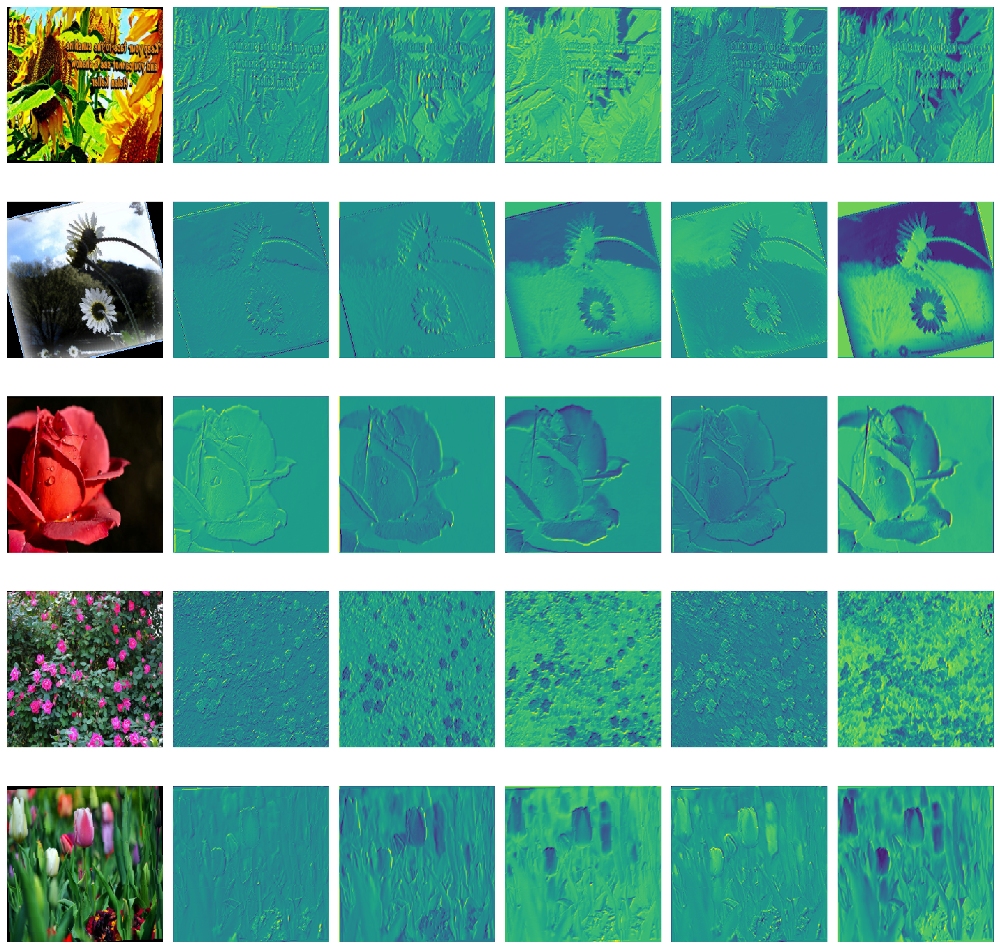
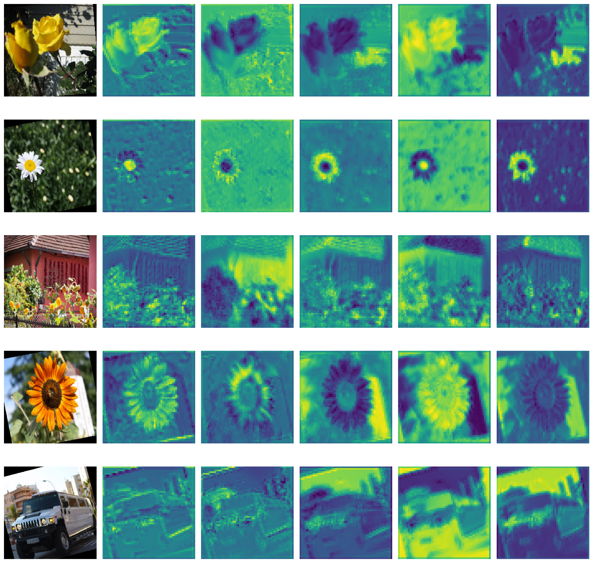
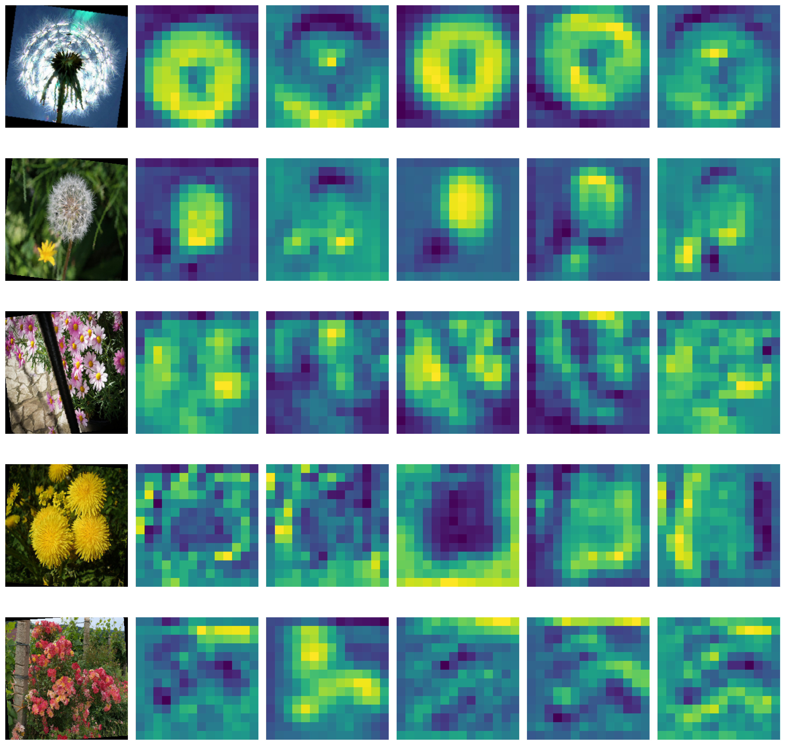
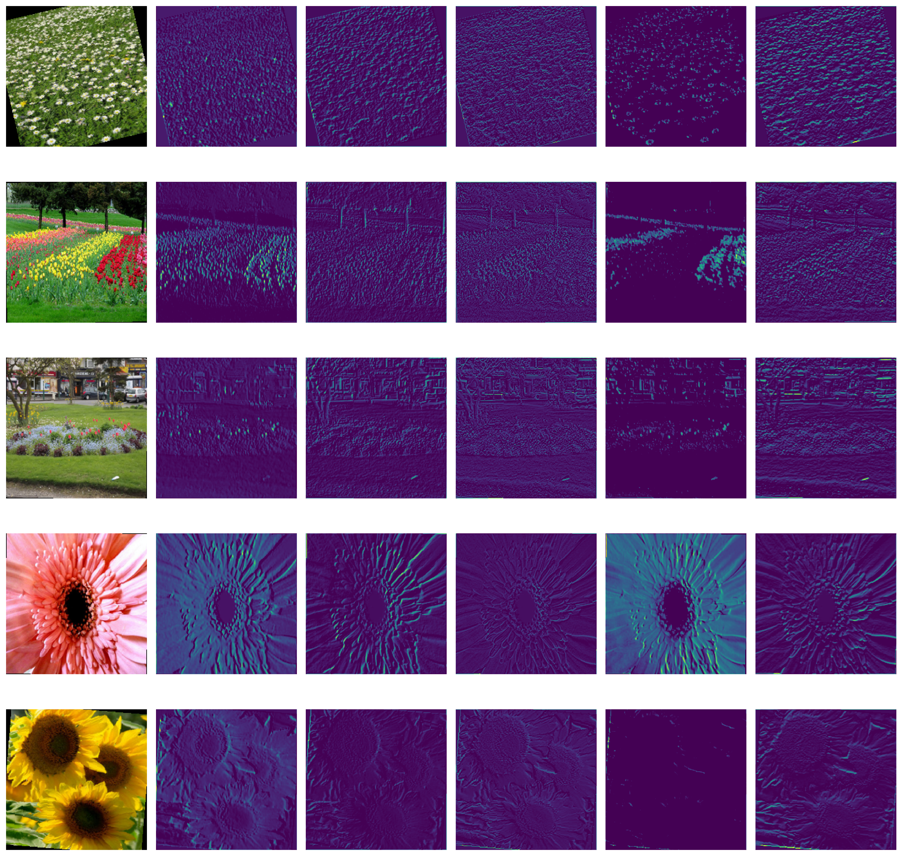
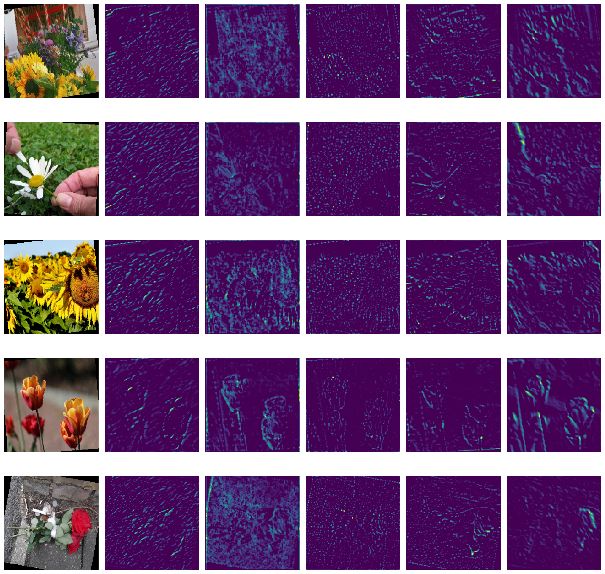
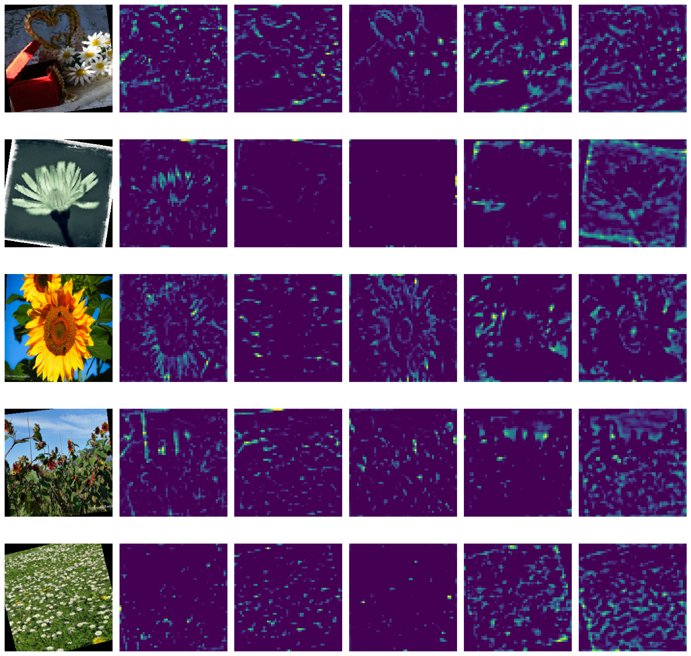

# Flower Classification - SE3508 Midterm Assignment

## Project Overview
This project is a midterm project for the SE3508 Introduction to Artificial Intelligence course. 

The models are trained on the [Flowers Dataset](https://www.kaggle.com/datasets/imsparsh/flowers-dataset/data) containing 5 flower categories: Daisy, Dandelion, Rose, Sunflower, and Tulip.

## Project Structure
flower-classification/
├── datasets/
│ └── flowers/
│   ├── train/
        └── daisy/
        └── dandelion/
        └── rose/
        └── sunflower/
        └── tulip
│   └── test/
├── models/
│ ├── custom_cnn.py
│ ├── vgg16_feature_extractor.py
│ └── vgg16_finetuned.py
├── outputs/
│ ├── saved_models/
├── visualizations/
    └── custom_cnn_conv1.png
    └── custom_cnn_conv3.png
    └── custom_cnn_conv5.png
    └── vgg16_conv1.png
    └── vgg16_conv3.png
    └── vgg16_conv5.png
├── utils/
│ ├── data_loader.py
│ ├── evaluate.py
│ ├── visualize.py
| |── performance_comparison.py
| |── save_model.py
| |── train.py
│ └── visualize.py
├── train_custom_cnn.py
├── train_vgg16_feature_extractor.py
├── train_vgg16_finetuned.py
├── requirements.txt
└── README.md

## Installation
1. Clone the repository:
''' bash
git clone https://github.com/ibrahimbinbuga/flower-classification.git
cd flower-classification
'''

2. Install dependencies:
''' bash
pip install -r requirements.txt
'''

## Model Architectures

1. Custom CNN
- 5 convolutional layers
- MaxPooling after conv layer
- 2 fully connected layers
- Trained from scratch

2. VGG16 Feature Extractor
- Pretrained VGG16 with frozen weights
- Only final layer trained
- Used as feature extractor

3. VGG16 Fine-Tuned
- First layers frozen
- Learning rate reduced

## Performance Results
| Model                   | Accuracy | Precision | Recall | F1 Score | Train Time (seconds) |
| ----------------------- | -------- | --------- | ------ | -------- | -------------------- |
| Custom CNN              | 61.03 %  | 0.6516    | 0.6103 | 0.5941   | 1385                 |
| VGG16 Feature Extractor | 90.64    | 0.9082    | 0.9064 | 0.9067   | 3286                 |
| VGG16 Finetuned         | 95.85    | 0.9586    | 0.9585 | 0.9585   | 7133                 | 

## Layer Visualizations

*custom_cnn_conv1.png*

*custom_cnn_conv3.png*

*custom_cnn_conv5.png*

*vgg16_conv1.png*

*vgg16_conv3.png*

*vgg16_conv5.png*

## Model Comparison
1. Run performance_comparison.py:
''' bash
python performance_comparison.py
'''

## Analysis
- Custom CNN achieved reasonable accuracy despite being trained from scratch.
- VGG16 Feature Extractor showed the benefits of transfer learning.
- Fine-Tuned VGG16 delivered best performance by adapting pretrained features.

## References
- Simonyan, K., & Zisserman, A. (2014). Very Deep Convolutional Networks for Large-Scale Image
Recognition. 
- Zeiler, M. D., & Fergus, R. (2014). Visualizing and Understanding Convolutional Networks.

## Credit
*This project was completed as part of the SE3508 Introduction to Artificial Intelligence course, instructed by Dr. Selim Yılmaz, Department of Software Engineering at Muğla Sıtkı Koçman University, 2025.*

*Note: This repository must not be used by students in the same faculty in future years—whether partially or fully—as their own submission. Any form of code reuse without proper modification and original contribution will be considered by the instructor a violation of academic integrity policies.*